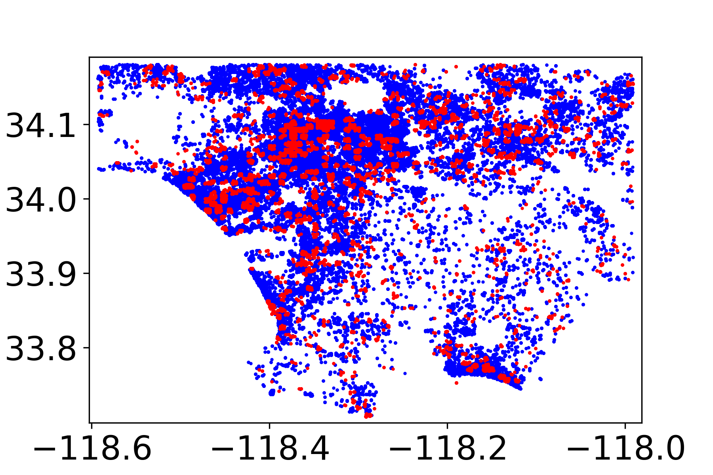
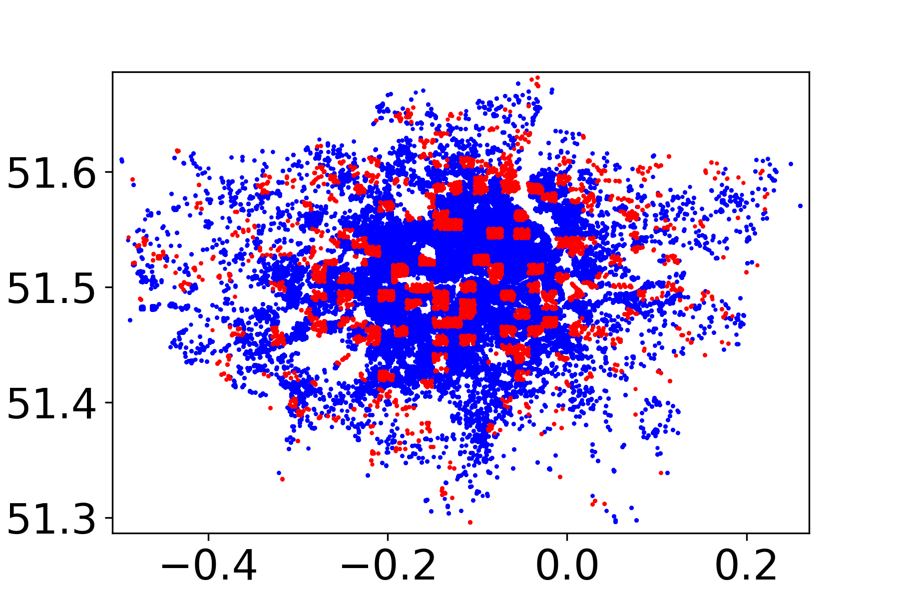
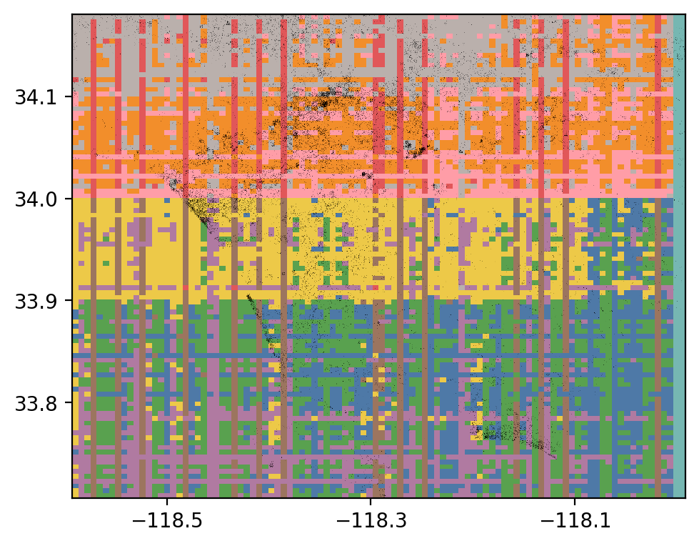
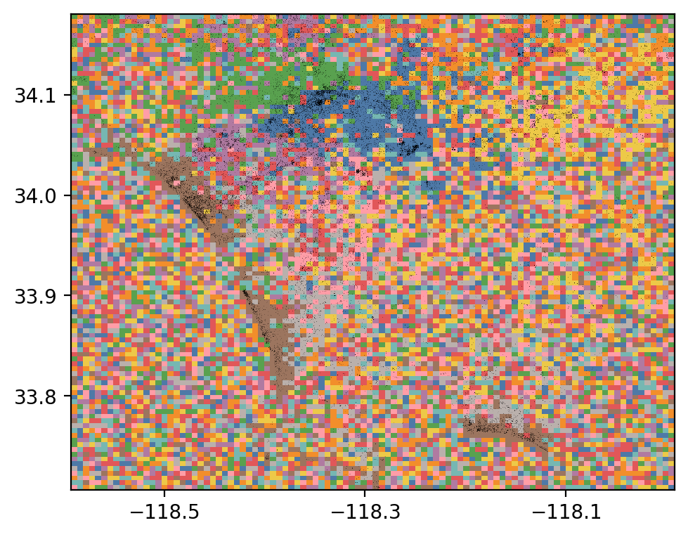
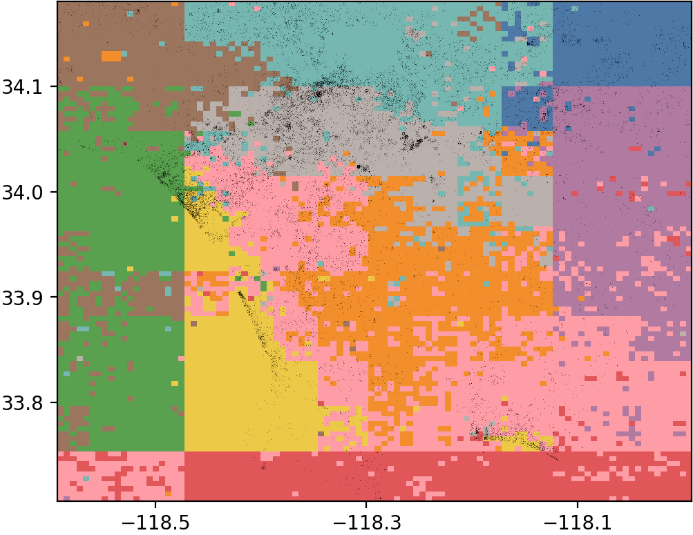
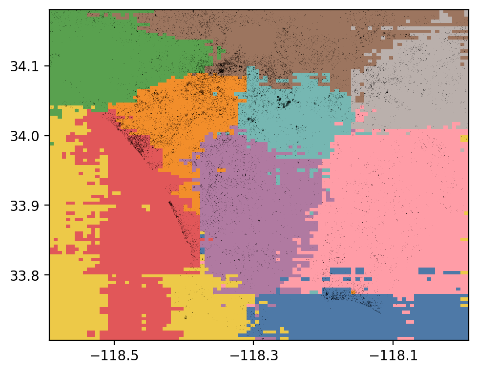
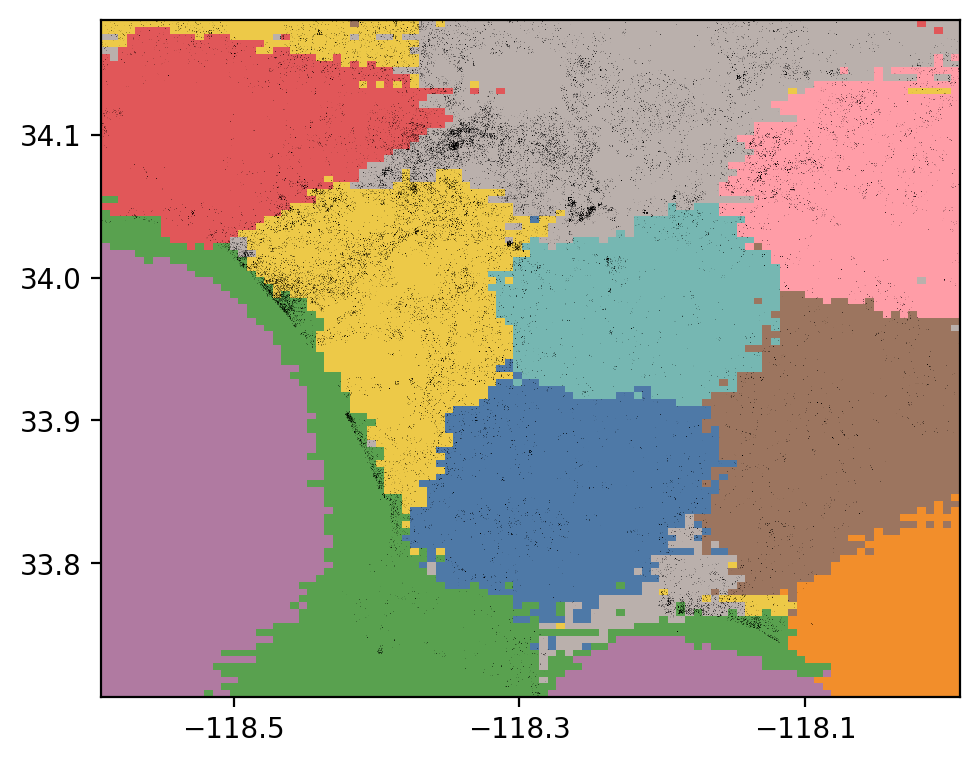
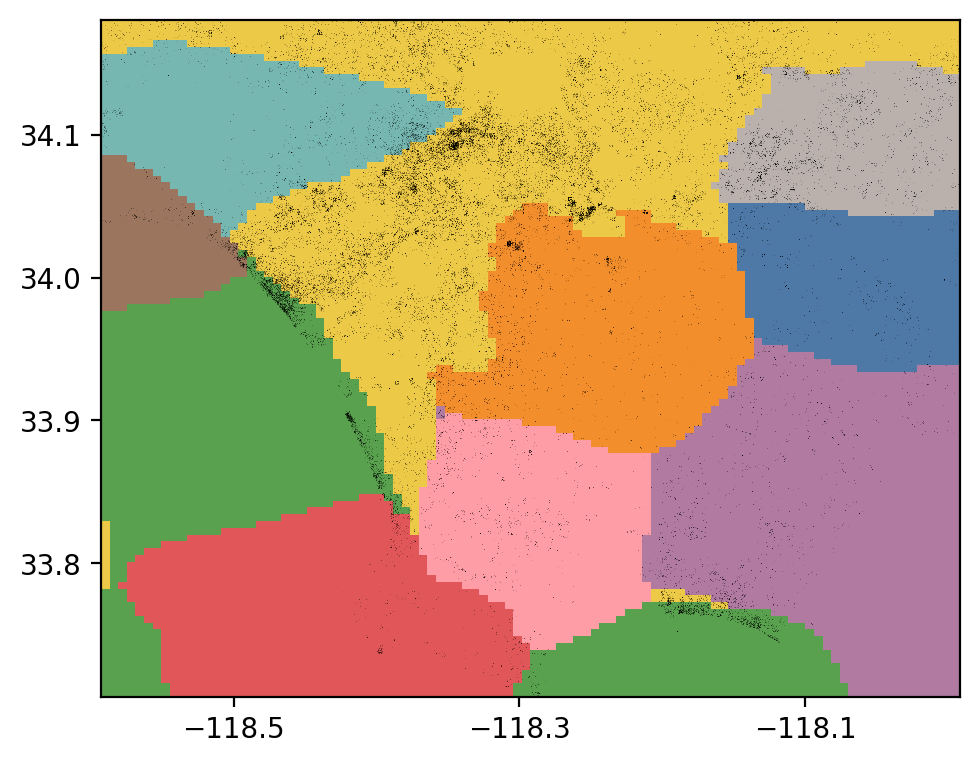

# GeospatialReasoning

> 🚀  Defining **real** geospatial reasoning

----

Code and data for **From Geographic Memory to Spatial Generalization in Large Language Models**. 

This repository studies how the **representation of location** affects an LLM’s ability to recover observed location–description associations (**geospatial memory**) versus predict descriptions for locations in unobserved regions (**spatial generalization**). Locations are injected into a base LLM (default: [`google/gemma-4-12B-it`](https://huggingface.co/google/gemma-4-12B-it)) via LoRA fine-tuning under five representation methods.

## Spatial representations

| Name | Config value | How the location is shown to the LLM |
| --- | --- | --- |
| **LATENT** | `LATENT` | Continuous location encoding projected into the model’s embedding space and supplied as a learned `<GEO>` token |
| **GRID** | `GRID` | Location mapped to an \(n \times n\) grid cell; a learned cell embedding is injected |
| **HASH** | `HASH` | Length-9 Base32 geohash (~2.4 m cells) written as prompt text |
| **TEXT** | `TEXT` | Raw `(latitude, longitude)` written as prompt text |
| **HYBRID** | `HYBRID` | TEXT coordinates in the prompt, immediately followed by the LATENT `<GEO>` embedding |

Configs live under `configs/` (`la_gemma4_*.yaml`, `london_gemma4_*.yaml`). Set `model.spatial_representation` to one of the values above.

## Dataset

We build paired location–description data from Airbnb property overviews in **Los Angeles** and **London**. Each city is partitioned into spatially disjoint training and test regions so captioning on the test split measures generalization beyond the spatial coverage of training observations.

### Train / test spatial coverage

|                         Los Angeles                             |                     London                                   |
| ----------------------------------------------------------- | ------------------------------------------------------------------- |
|  |  |

*Blue: training locations. Orange: held-out test locations used for spatial generalization.*

### Captioning data (`data/`)

One row = one **(location, description)** pair. The same listing `id` / coordinate can appear with multiple descriptions.

| File | Rows (approx.) | Unique locations |
| --- | ---: | ---: |
| `data/LA_training.csv` | 179 801 | 26 853 |
| `data/LA_test.csv` | 46 449 | 7 079 |
| `data/London_training.csv` | 177 511 | 32 354 |
| `data/London_test.csv` | 42 672 | 7 902 |

Columns:

```text
id, latitude, longitude, description
```

Example:

```csv
id,latitude,description,longitude
2732,34.0044,in Santa Monica,-118.48095
```

### Grounding data (`data/grounding/`)

Grounding evaluates whether descriptions map back to geographic space. Files store **one extracted general description versus multiple point locations** that share that description (after normalization / clustering).

| File | Rows (approx.) | Unique descriptions |
| --- | ---: | ---: |
| `data/grounding/la_grounding.csv` | 39 964 | 2 749 |
| `data/grounding/london_grounding.csv` | 67 391 | 3 964 |

Columns:

```text
Index, id, latitude, longitude, description, norm_description, cluster, cluster_label, cluster_row_count
```

- `norm_description` / `cluster_label`: the shared general description
- each row: one point that carries that description

This repo ships the grounding **datasets**; captioning training / generation is implemented in `src/SpatialExplicitLM/`.

## Setup

```bash
pip install -r requirements.txt
export PYTHONPATH=src
```

Base LLMs are loaded from Hugging Face (or a local cache). All other inputs and outputs stay inside this folder (`data/`, `configs/`, `outputs/`).

Optional: set GPUs with `runtime.cuda_visible_devices` in a config (e.g. `"0"` or `"0,1"`), or leave it empty to use the default visible devices.

## Usage

Train (example: LA + LATENT):

```bash
python -m SpatialExplicitLM.train --config configs/la_gemma4_LATENT.yaml
```

Captioning evaluation has two separate settings; choose one with `--mode`:

| `--mode` | What is evaluated | Data used |
| --- | --- | --- |
| `memory` | Recovery of observed location–description associations | Training locations |
| `generalization` | Prediction in spatially unobserved regions | Held-out test locations |

Generate descriptions:

```bash
# Geospatial memory (observed / training locations)
python -m SpatialExplicitLM.generate --config configs/la_gemma4_LATENT.yaml --mode memory

# Spatial generalization (withheld / test locations)
python -m SpatialExplicitLM.generate --config configs/la_gemma4_LATENT.yaml --mode generalization
```

Evaluate a checkpoint (same `--mode` choice):

```bash
python -m SpatialExplicitLM.evaluate --config configs/la_gemma4_LATENT.yaml \
  --checkpoint outputs/checkpoints/la_LATENT/best --mode memory

python -m SpatialExplicitLM.evaluate --config configs/la_gemma4_LATENT.yaml \
  --checkpoint outputs/checkpoints/la_LATENT/best --mode generalization
```

Checkpoints are written under `outputs/checkpoints/`; generations under `outputs/generations/` (filenames include the chosen mode).

## Project layout

```text
configs/                  # YAML configs for LA / London × five representations
data/                     # Captioning train/test CSVs
data/grounding/           # Grounding CSVs (one description → many points)
figs/                     # Train/test scatter plots and cluster maps
outputs/checkpoints/      # Training outputs (created at runtime)
outputs/generations/      # Generation pickles (created at runtime)
src/SpatialExplicitLM/    # Model, data loading, train / generate / evaluate
```

## How LLMs perceive space under each representation

Clustering the captioning model’s generation-token hidden states and mapping clusters back to geography shows how each representation organizes space. **NAIVE** is an untuned baseline (no task-specific fine-tuning). Among tuned methods, continuous **LATENT** encodings tend to form more contiguous regions than TEXT, HASH, or GRID.

|                                                      |                                                         |                                                         |
| ---------------------------------------------------- | ------------------------------------------------------- | ------------------------------------------------------- |
|  *NAIVE* |  *GRID*       |  *HASH*       |
|  *TEXT*    |  *HYBRID* |  *LATENT* |

*Los Angeles cluster maps (Qwen family illustrated here).*

## Citation

If you use this repository, please cite the accompanying paper (under review):

```bibtex
@inproceedings{geospatialreasoning2027,
  title     = {From Geographic Memory to Spatial Generalization in Large Language Models},
  author    = {Chen Chu, Zhaonan Wang, Cyrus Shahabi, Hengcai Zhang, Feng Lu},
  year      = {2026}
}
```

## License

This project is released under the [MIT License](LICENSE).
